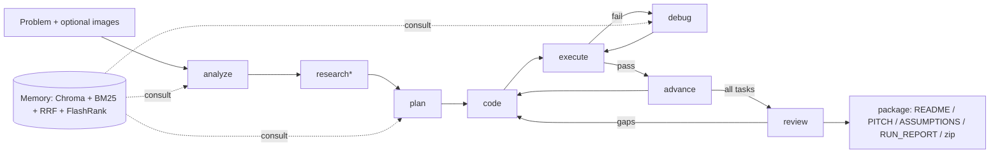

# HackAgent: an autonomous hackathon-solving agent

One prompt in, a complete runnable project out. HackAgent's "experience" comes from expert YouTube courses (demo: Karpathy's *Neural Networks: Zero to Hero*). Their transcripts become a cited RAG memory, a `persona.md`, and per-course `COURSE_NOTES.md`.



## Quick start
```bash
./run.sh install
```
```bash
cp .env.example .env   # add ANTHROPIC_API_KEY (optional: TAVILY_API_KEY, LANGSMITH_API_KEY)
```
```bash
./run.sh ingest        # real playlist (default: Zero to Hero); or: ./run.sh ingest --samples
```
```bash
./run.sh persona && ./run.sh notes
```
```bash
./run.sh app           # Streamlit UI
```
CLI: `./run.sh agent "Build a web app that detects plant disease from a leaf photo... 24-hour hackathon."`

## Features
- **Builder agent** (`agent/graph.py`): LangGraph `StateGraph` + `SqliteSaver` (resumable), with no human in the loop. Hard budgets (`MAX_ITERATIONS`, `MAX_DEBUG_LOOPS`, `MAX_WALL_MINUTES`, `MAX_TOKENS_BUDGET`) jump straight to `package`.
- **Sandbox** (`agent/sandbox.py`): per-run venv, timeouts on every command, path-escape and destructive-command blocking.
- **Memory** (`memory.py`): `consult(q, k=6)` runs multi-query rewrite, vector + BM25 retrieval, Reciprocal Rank Fusion, and a FlashRank rerank, then returns chunks with timestamp citations.
- **Per-course notes** (`notes.py`): `courses/{slug}/COURSE_NOTES.md` with a summary, timestamped takeaways and a glossary for each lecture.
- **Multimodal**: attach screenshots or sketches to a build or a copilot chat. They are sent to Claude vision.
- **Copilot** (`agent/toolagent.py`): a ReAct tool agent with `consult_expert`, `read_course_notes`, `web_search`, `run_python`, `list_runs`, `read_run_file` and `build_project`.
- **Tracing**: set `LANGSMITH_API_KEY` and every graph node and tool call is traced to project `hackagent`.
- **Offline mode**: without an API key, the graph still runs end to end, using project templates and heuristics.

## Layout
`config.py` · `llm.py` · `embeddings.py` · `ingest.py` · `persona.py` · `memory.py` · `notes.py` · `agent/{graph,nodes,state,sandbox,docs,toolagent}.py` · `agent/templates/` · `app.py` · `run.sh` · `tests/`
